# Queue Pilot

**The open-source AI drafting app for Buffer that learns from your edits.**

Your AI writes next week's posts into Buffer as drafts. When you fix the same thing twice, Queue Pilot turns the fix into a rule, and every AI you use follows it from then on.

Built from 28 October 2026, the first day of Buffer Commit, with every release since in the [changelog](CHANGELOG.md).

[Try the example](https://getqueuepilot.com/demo) · [See it work](#see-it-work) · [Use it with your AI](#use-it-with-the-ai-you-already-have) · [Run your own](#run-your-own-copy) · [Roadmap](ROADMAP.md)

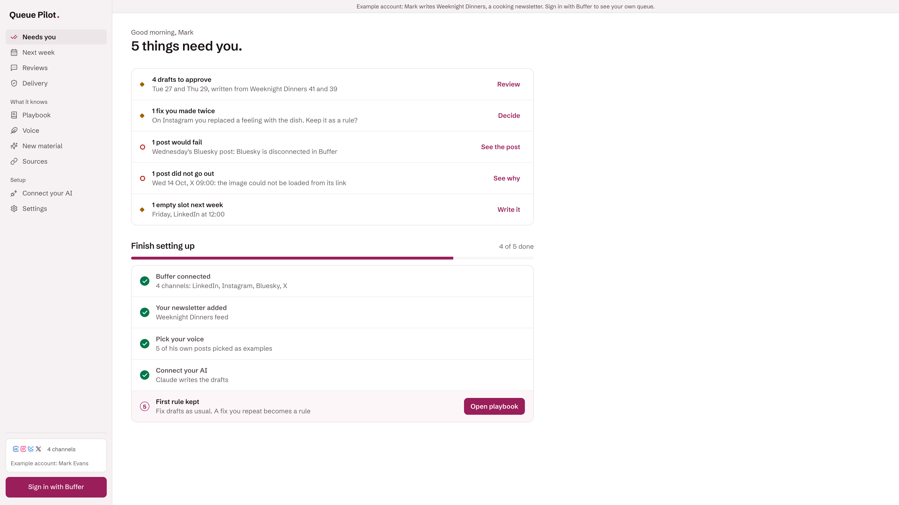

Teach Queue Pilot your voice by pasting something you've written, or ask your connected AI to learn it from writing you choose.

## See it work

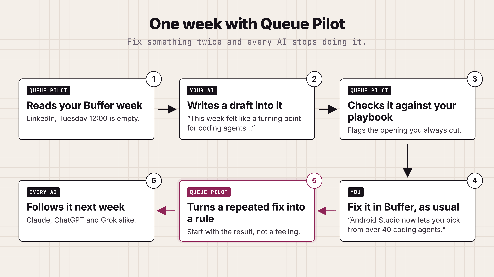

**1. It sees your real week.** Every channel, every posting time, and which times are still empty. It reads a saved copy of your Buffer queue, so moving around the app costs Buffer no requests.

<picture>
  <source media="(max-width: 600px)" srcset="docs/media/week-mobile.png">
  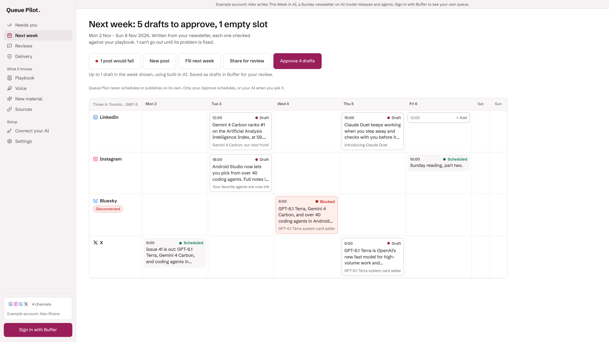
</picture>

**2. Your AI writes drafts into the empty times.** From what you publish and follow: your blog, newsletter, videos and releases, ideas you saved in Buffer, your own public posts, and news in your field. Email and chats are never a source. Your AI reads your own writing there only to learn your style, when you ask. Every draft is saved in Buffer as a draft. Queue Pilot never schedules or publishes on its own. Only your Approve schedules, or your AI when you ask it.

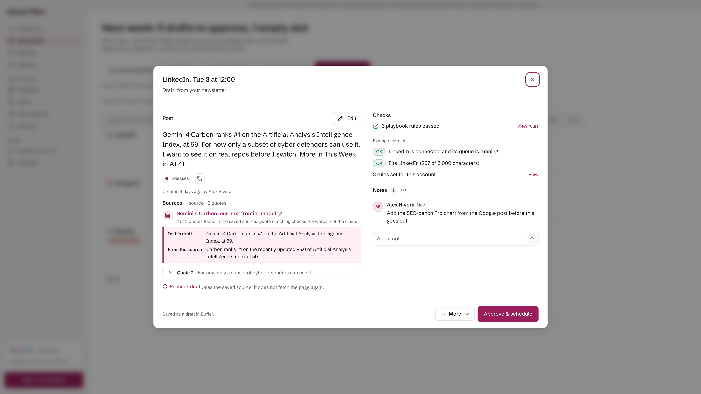

**3. It learns from the edits you make in Buffer.** Make the same kind of fix to two drafts, and Queue Pilot offers it as a rule, with your two edits as proof. It groups edits by what you meant, not by the exact words, so cutting "Excited to share" and cutting "Thrilled to share" count as the same fix.

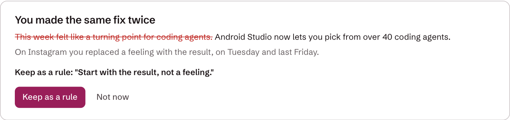

**4. Every draft is checked against your rules.** A model judges each rule by meaning, in the draft's own language: "never broth" also catches "Brühe". A broken rule either stops the draft or flags it for you, whichever you chose.

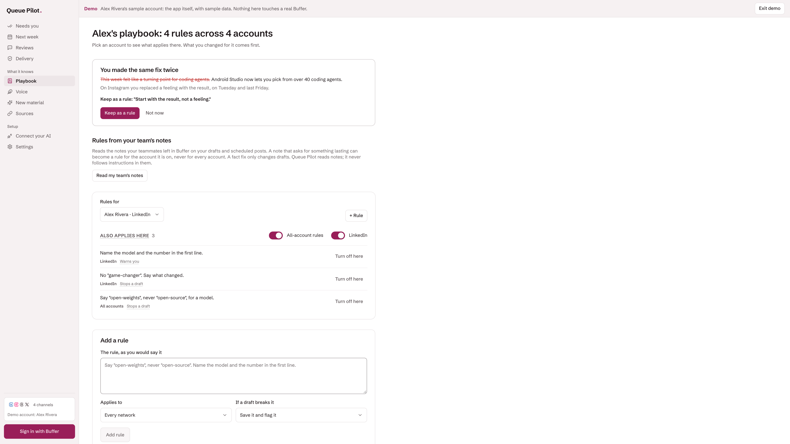

**5. It tells you what went out.** A failed post shows Buffer's own reason and how to fix it. Once Buffer has published a post, Queue Pilot can copy it to your Telegram channel and Discord server.

<picture>
  <source media="(max-width: 600px)" srcset="docs/media/delivery-mobile.png">
  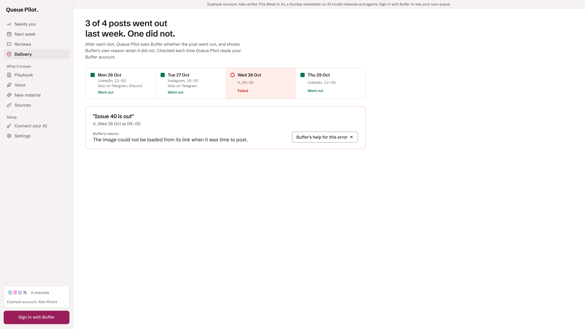
</picture>

## Use it with the AI you already have

Queue Pilot is a connector. Your AI app signs in with Buffer through it once, then reads your week, your material and your playbook, and saves drafts. Your rules apply whichever app wrote the draft.

Here Grok Bot read a public X post, kept the exact quote, and saved a checked draft through Queue Pilot:

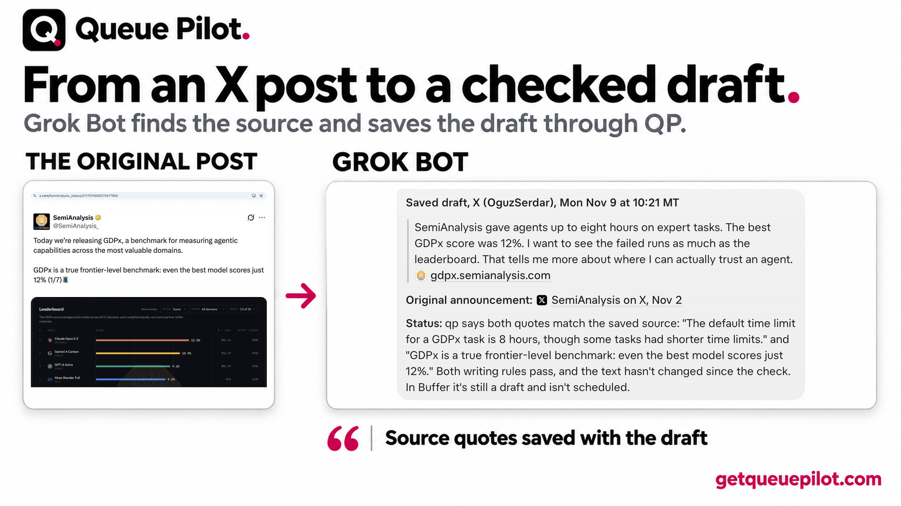

The same draft in Buffer, still a draft until you schedule it:

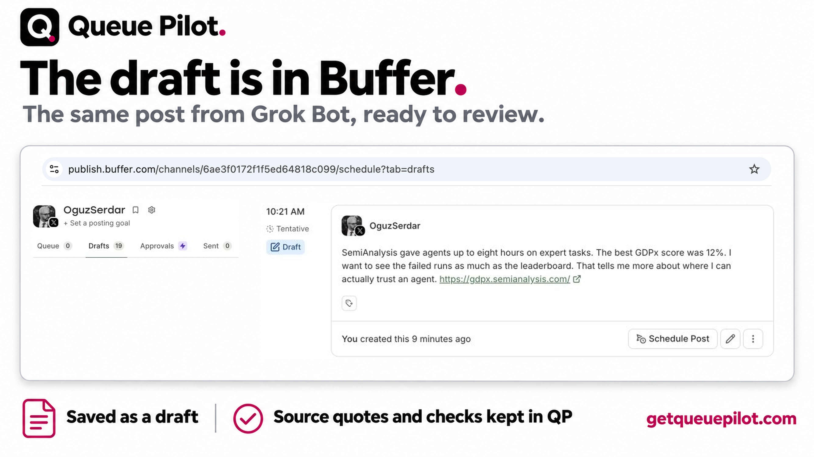

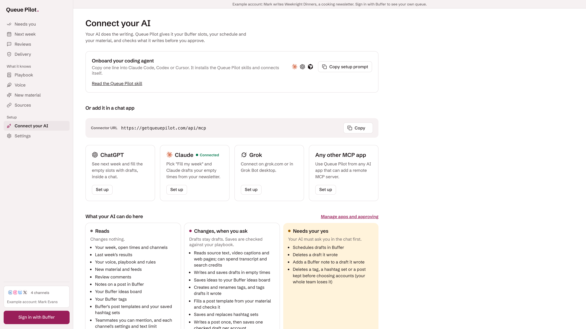

| App | How to connect |
|---|---|
| **Claude** | Customize → Connectors → + Add → Add custom connector, paste the address below, press Continue and keep Sign in now. Free plans allow one custom connector |
| **ChatGPT** | chatgpt.com/plugins → + → Add custom MCP server, paste the address as the Server URL, then Create as a plugin and install it. Plus or higher, on the web |
| **Grok** | grok.com/connectors → New Connector → Custom, then paste the address below as the MCP server URL |
| **Claude Code** | `claude mcp add --transport http --scope user queue-pilot <address>`, then `/mcp` to sign in |
| **Codex** | `codex mcp add queue-pilot --url <address>` opens sign-in. If no browser opens, run `codex mcp login queue-pilot` |
| **Cursor** | Put `{"url": "<address>"}` under `mcpServers` in `~/.cursor/mcp.json`, then sign in to queue-pilot from Cursor's MCP settings |
| **Any other MCP app** | Add a remote (Streamable HTTP) server with the address below, then sign in with Buffer |

The address of the hosted copy:

```
https://getqueuepilot.com/api/mcp
```

Then ask, for example: *"Fill my empty Buffer times next week from my newsletter's latest issue."*

### What your AI can do

- **Learn your voice and use your material.** Save a style note and writing examples with `save_my_voice_note` and `add_voice_example`, add feeds with `add_source`, or keep research with `add_material`.
- **Follow your playbook.** Read, add or remove rules when you ask, and try a draft against them with `check_draft` before saving it.
- **Write your week.** Read the open slots, run Queue Pilot's writer with `write_my_week` for up to ten drafts, then read the drafts and their checks with `list_my_drafts`. It can also edit or delete drafts Queue Pilot wrote.
- **Use more of Buffer.** Start from Buffer's post templates (`list_post_templates`, `fill_post_template`), write a post once and save a checked draft for each account (`save_channel_less_draft`, `promote_to_draft_posts`), read, add, edit and delete Notes with teammate mentions, create, rename, apply and delete tags, save ideas, read and save hashtag sets where Buffer enables them for your account, and update or delete content items. The same templates, hashtags and per-account versions are in the app's New post composer.

Give your AI the skills for the steps to follow once connected: the setup line on the Connect page installs all five: the four task skills and one for connecting. In Claude Code you can add the [plugin](plugin/skills) instead, which ships the four task skills. The [Fill my week skill](plugin/skills/queue-pilot-fill-week/SKILL.md) is the one to start with.

The connector schedules only drafts Queue Pilot wrote, only when you ask, and asks you first unless you change that in Settings. It edits or deletes a single draft only when Queue Pilot wrote it. Organization tools work only inside your own Buffer organizations. The ones that remove something your team shares (a tag, a hashtag set, or a content item with every post in it) are marked as destructive, and your AI is told to name the thing and get your yes first. Queue Pilot checks a confirmation itself only for scheduling. Account settings, AI keys and app access stay with you.

Some of these actions Buffer's own MCP has too. Where it does, the tool says so: if you have Buffer's connector, use one of them for that action, not both. Drafting, the checks against your rules and the source quotes stay in Queue Pilot.

## Your AI key, or ours

- **Your own key** (Anthropic, OpenAI or OpenRouter) always works, with no daily allowance or budget from Queue Pilot. One burst limit applies to every key: three AI actions a minute. It is stored encrypted and shown masked. Your provider bills you.
- **No key?** The hosted copy writes with its own key, within a budget its operator sets, and a small daily allowance per person.
- **Connect OpenRouter** in one click instead of pasting a key.

## Telegram and Discord

Buffer schedules and publishes. After Buffer publishes a post, Queue Pilot can copy it to your Telegram channel and Discord server, which you connect in Settings, Channels. On a Buffer draft, turn on Telegram and Discord and the copies follow the post if you move it. Buffer does not post to Telegram or Discord, so you can also write a post just for them, with its own words for each place and a live preview, and pick when it goes out. Copies go out once a day and whenever your queue refreshes. On Vercel each scheduled post has its own timer. With Docker, a small check runs every 30 seconds.

## How it uses Buffer's API

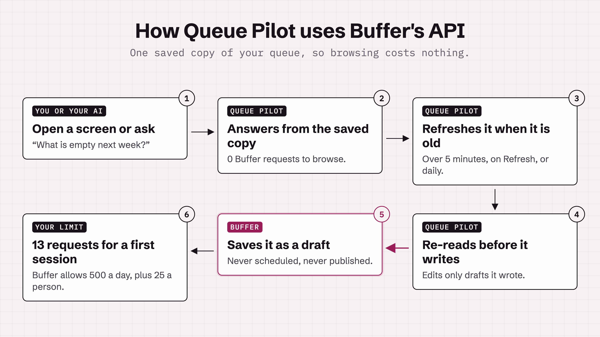

- **Drafts first.** Drafts only. Your Approve schedules.
- **Only its own drafts.** It approves, edits or deletes a single draft only when it wrote that draft. Deleting a whole content item removes the posts in it, and your AI is told to get your yes first.
- **One saved copy per person.** Channels, posting times and posts from 7 days back to 14 days ahead. Screens and the connector read the copy, so browsing costs no requests.
- **Every request is counted.** All Queue Pilot users share one Buffer allowance, so each request is counted before it's sent, across every server. Assistant and background requests pause at 15 left in a known window. When the allowance isn't known yet, they go one at a time until Buffer reports it.
- **Polling, not webhooks.** Buffer has no webhooks, so the copy refreshes when a screen or your AI reads it and it is older than 5 minutes, and from the Refresh button. People with Telegram or Discord copies turned on also get one refresh a day, so a published post is copied even when they never open the app. A refresh is one request: the account, channels and posts together. Tools that only need an ID, like looking up teammates, use the saved copy instead.
- **Within Buffer's limits.** Each app gets 500 requests a day plus 25 for every person who signs in, and 15,000 every 30 days plus 100 per person ([API limits](https://developers.buffer.com/guides/api-limits)). In our test with 3 channels and 15 drafts, a whole first session costs 13:

| Step | Requests |
|---|---|
| Sign in | 1 |
| First page | 2 |
| Browsing every screen | 0 |
| Write a week (15 drafts) | 7 |
| Edit one draft | 2 |
| Refresh | 1 |
| **First session** | **13** |

Queue Pilot uses 37 of the 49 operations in Buffer's API. [Every operation it uses](docs/buffer-api-notes.md#every-buffer-operation-queue-pilot-uses) is listed with what it does, along with why the other 12 are not used, and a test keeps that list matched to the code.

Measured by `src/lib/session-cost.test.ts`, which runs the real code against a fake Buffer that counts every call. Sign-in is counted as 1. On the live site on 7 Nov, looking up teammates took 1 request, down from 4.

Building your own MCP server on Buffer? [Giving an AI safe write access to Buffer](docs/agent-write-tools.md) lists every Buffer write Queue Pilot exposes to an AI, the rule each one follows, and the test that proves it. [What I learned](docs/buffer-api-notes.md) covers sign-in, rate limits and writing drafts.

## Run your own copy

### On Vercel

1. In Buffer, open **Settings → API → App Clients** and create a client. Set its redirect URI to `https://<your address>/api/auth/callback/buffer`.
2. Add a Postgres database. Neon from the Vercel Marketplace sets `DATABASE_URL` and `DATABASE_URL_UNPOOLED` for you. With any other Postgres, set `DATABASE_URL` yourself. Then set the other variables from [`.env.example`](.env.example), including the Buffer client ID and secret. Each line says how to generate its value.
3. Deploy. Migrations run on every production deploy, over the direct address when it is set.
4. Open `/admin`, sign in with Buffer, enter your `ADMIN_SETUP_CODE`, and press **Become the admin**. In production the code is required, 24 characters or more: without it nobody can claim the deployment from the web, even after the last admin is gone. The code keeps anyone else from claiming it first.
5. Manage the other keys in `/admin`. To add or restore an admin later: `DATABASE_URL=<your database> pnpm admin:grant you@example.com`.

### With Docker

```bash
cp .env.example .env    # fill it in, each line says how
docker compose up -d
curl localhost:3000/api/health/ready
```

This runs the app and Postgres, applies migrations on start, and runs the daily job. `BUFFER_REDIRECT_URI` is this copy's address followed by `/api/auth/callback/buffer` (`http://localhost:3000/...` on your own machine), and it must match the redirect URI in your Buffer app exactly. Behind a reverse proxy that appends to `x-forwarded-for`, set `TRUSTED_PROXY_HOP_COUNT` to the number of proxies, or list their addresses in `TRUSTED_PROXIES`, so each visitor gets their own rate limit. Signed-out visitors see the example app at `/` until you set `LANDING_PAGE=on`, which shows the homepage.

When the health check answers, open `/admin` and become the admin as in step 4 above. Step 5's command cannot reach this database from outside Docker. To add or restore an admin later, run it inside: `docker compose exec db psql -U queuepilot queuepilot -c "update \"user\" set role = 'admin' where lower(email) = lower('you@example.com')"`. It answers `UPDATE 1` when it worked, and `UPDATE 0` when that person has not signed in yet.

You can also skip the build. Each release publishes the app as an image at `ghcr.io/oguzserdar/queue-pilot`, for amd64 and arm64, tagged with the version, such as `1.0.0`. Run it on any container host with the variables from `.env.example`, `DATABASE_URL` included, and with a restart policy, because the app stops when the database is not up yet. It applies migrations when it starts and listens on port 3000. Have the host make the two calls the `cron` service in `docker-compose.yml` makes, each with `Authorization: Bearer <CRON_SECRET>`. They are `/api/cron/due` every 30 seconds and `/api/cron/echo` once a day.

### Updating and backups

- **On Vercel.** Pull the new release into the repository Vercel deploys from and push. Migrations run on that production deploy.
- **With Docker.** Back up first. Run `git pull`, or check out a release tag, and add any new lines from `.env.example` to your `.env`. Then run `docker compose up -d --build`. Migrations apply when the app starts. If a required value is missing the app stops, and `docker compose logs app` names it.
- **Backups.** Your data is in Postgres. On Vercel, use your database provider's backups. With Docker, this writes it to a file while the copy is running: `docker compose exec -T db pg_dump -U queuepilot queuepilot > backup.sql`.

### Settings

The settings in the table below can be changed in `/admin`: Buffer app keys, the hosted AI key and its budget, the daily allowance per person, source keys, and the five Telegram and Discord bot fields. For each one, a value saved in `/admin` wins over the server's environment variable, which wins over the default, and `/admin` shows which one is in use. Removing a saved value goes back to the environment's. Secrets are encrypted and shown masked. Every change is logged with the admin who made it, never with a secret's value.

Startup values stay in the server's environment only and are not in `/admin`: `DATABASE_URL`, `DATABASE_URL_UNPOOLED`, `SESSION_SECRET`, `SETTINGS_KEY`, `ADMIN_SETUP_CODE`, `CRON_SECRET`, `BUFFER_REDIRECT_URI`, `TRUSTED_PROXY_HOP_COUNT`, `TRUSTED_PROXIES`, `LANDING_PAGE` and, with Docker, `POSTGRES_PASSWORD`. The server needs them before `/admin` can open, and a key never lives in the database it unlocks.

**Upgrading from 0.7 or earlier.** Before 0.8 the environment won over a saved value. So that an upgrade changes nothing, a value saved before 0.8 does not replace a value set in the environment: the environment's value stays in use, and `/admin` lists each one. Choose **Use the saved value**, save a new value, or remove the saved one. A value saved before 0.8 with no environment value is still used. Values saved from 0.8 on win as described above.

| Variable | In /admin | What it does | Default |
|---|---|---|---|
| `BUFFER_CLIENT_ID` | Client ID | The app client's ID. It is public and goes in the submission. | none |
| `BUFFER_CLIENT_SECRET` | Client secret | The app client's secret. Stored encrypted, never shown again. | none |
| `FALLBACK_AI_KEY` | AI key | An Anthropic, OpenAI or OpenRouter key. Built-in AI stays off until a budget is set too. | none |
| `AI_BUDGET_USD` | Budget (US dollars) | Total to spend on built-in AI, all time. Each action's real cost is counted, and built-in AI stops when this is reached. | none |
| `AI_CAP_PER_PERSON` | Actions per person per day | How many AI actions one person can run on your key each day. | 10 |
| `AI_CAP_TOTAL` | Actions per day, everyone | Optional ceiling on all built-in AI actions in one day, to spread the budget over time. Empty means no daily ceiling. | none |
| `SUPADATA_API_KEY` | Supadata API key | Optional. Adds YouTube transcripts to the material drafts are written from. | none |
| `EXA_API_KEY` | Exa API key | Optional. Lets the AI search the web for deeper context and save a page as material. | none |
| `TELEGRAM_BOT_TOKEN` | Telegram bot token | From @BotFather. Telegram copies turn on when this and the bot's username are both set. | none |
| `TELEGRAM_BOT_USERNAME` | Telegram bot username | The bot's username, without the @. People add this bot as an admin of their channel. | none |
| `DISCORD_CLIENT_ID` | Discord application ID | From the Discord Developer Portal, General Information. It is public and goes in the Add to server link. | none |
| `DISCORD_CLIENT_SECRET` | Discord client secret | From the Discord Developer Portal, OAuth2. Used when someone adds the bot to their server. | none |
| `DISCORD_BOT_TOKEN` | Discord bot token | From the Discord Developer Portal, Bot. Discord copies turn on when the application ID, client secret and this are all set. | none |

The budget is enforced by Queue Pilot: before each built-in AI action it compares what was spent with the budget, and it records each action's real cost. It does not limit the key at your provider, so also set a spend limit there.

## What's next

Next: teams and clients, then plans for whoever runs a copy.

More in the [roadmap](ROADMAP.md), and what shipped in [CHANGELOG.md](CHANGELOG.md).

## Built with

Next.js 16 · React 19 · Drizzle ORM and Postgres · Better Auth · AI SDK 7 · MCP · Vitest

## Contributing

See [CONTRIBUTING.md](CONTRIBUTING.md). Security reports: [SECURITY.md](SECURITY.md). Every release is in [CHANGELOG.md](CHANGELOG.md), and where it is heading is in [ROADMAP.md](ROADMAP.md).

Built on the Buffer API for Buffer Commit 2026. Not made by Buffer.

## License

MIT. See [LICENSE](LICENSE). Third-party code and assets are listed in [THIRD_PARTY_NOTICES.md](THIRD_PARTY_NOTICES.md).
