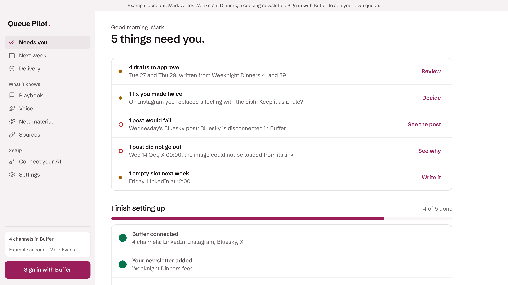
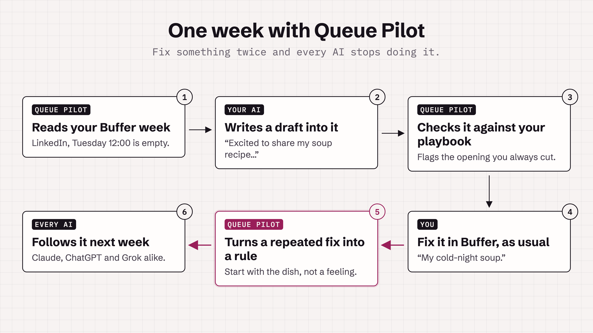
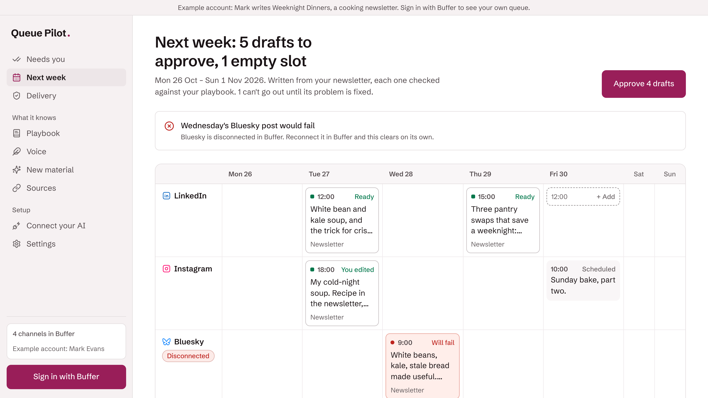
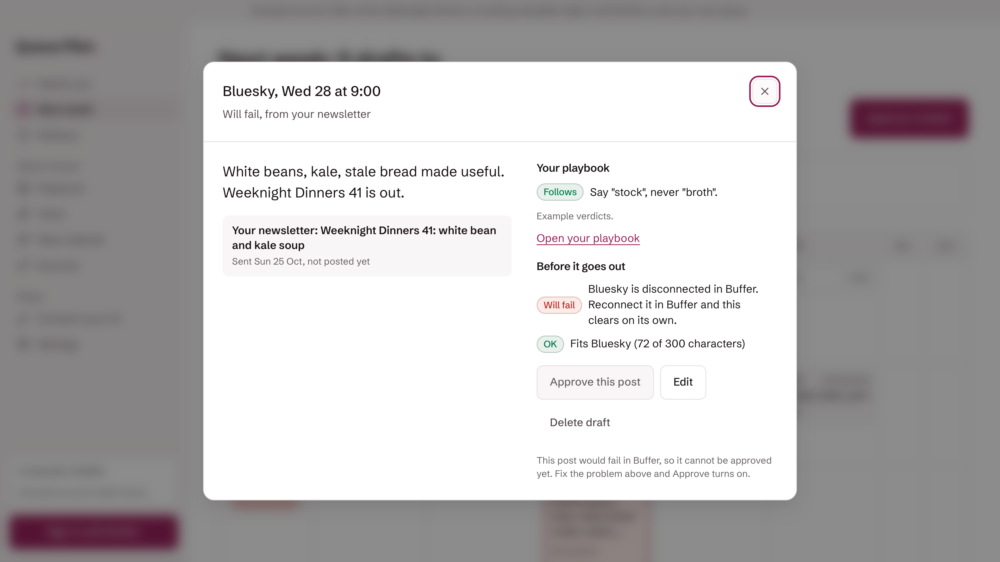
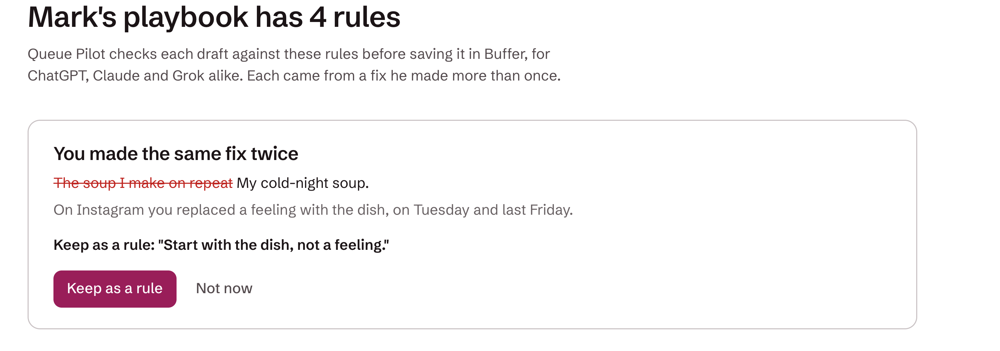
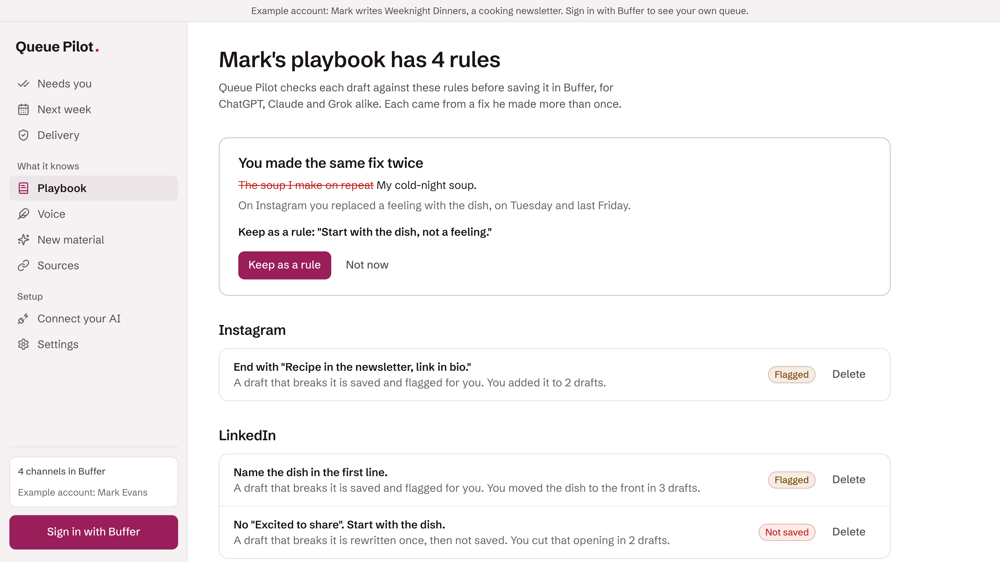
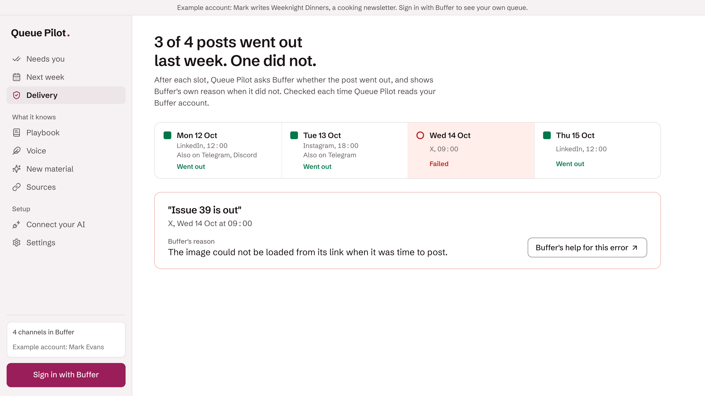
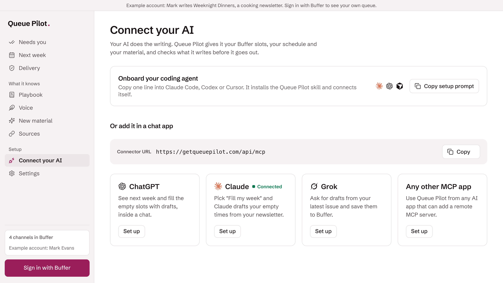
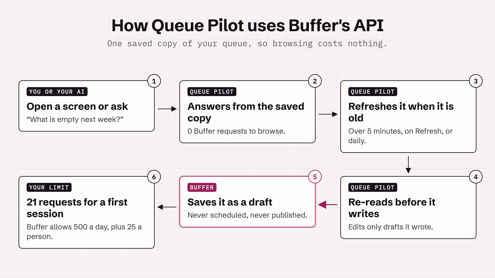

# Queue Pilot

**The open-source AI drafting app for Buffer that learns from your edits.**

Your AI writes next week's posts into Buffer as drafts. When you fix the same thing twice, Queue Pilot turns the fix into a rule, and every AI you use follows it from then on.

[Try the example](https://getqueuepilot.com) · [See it work](#see-it-work) · [Use it with your AI](#use-it-with-the-ai-you-already-have) · [Run your own](#run-your-own-copy) · [Roadmap](ROADMAP.md)



Teach your voice with a short note and pasted posts on the Voice screen, even with no sent posts.
Through the connector, use `save_my_voice_note` and `add_voice_example` when you want your AI to remember your style.
Use `add_source` for a feed or releases page, or `add_material` for research text with a title and optional link.
Read `get_my_voice`, `get_playbook` and `read_material` before drafting. `save_drafts` returns the checks and any refusals.

## See it work



**1. It sees your real week.** Every channel, every posting time, and which times are still empty. It reads a saved copy of your Buffer queue, so moving around the app costs Buffer no requests.

<picture>
  <source media="(max-width: 600px)" srcset="docs/media/week-mobile.png">
  
</picture>

**2. Your AI writes drafts into the empty times.** From your newsletter, your videos and your own past posts. Every draft is saved in Buffer as a draft. Queue Pilot never schedules or publishes anything.



**3. It learns from the edits you make in Buffer.** Make the same kind of fix to two drafts, and Queue Pilot offers it as a rule, with your two edits as proof. It groups edits by what you meant, not by the exact words, so cutting "Excited to share" and cutting "Thrilled to share" count as the same fix.



**4. Every draft is checked against your rules.** A model judges each rule by meaning, in the draft's own language: "never broth" also catches "Brühe". A broken rule either stops the draft or flags it for you, whichever you chose.



**5. It tells you what went out.** A failed post shows Buffer's own reason and how to fix it. Sent posts can be copied to your Telegram channel and Discord server.

<picture>
  <source media="(max-width: 600px)" srcset="docs/media/delivery-mobile.png">
  
</picture>

## Use it with the AI you already have

Queue Pilot is a connector. Your AI app signs in with Buffer through it once, then reads your week, your material and your playbook, and saves drafts. Your rules apply whichever app wrote the draft.



| App | How to connect |
|---|---|
| **Claude** | Customize → Connectors → + Add → Add custom connector, paste the address below, press Continue and keep Sign in now. Free plans allow one custom connector |
| **ChatGPT** | chatgpt.com/plugins → + → Add custom MCP server, paste the address as the Server URL, then Create as a plugin and install it. Plus or higher, on the web |
| **Grok** | grok.com/connectors → New Connector → Custom, then paste the address below as the MCP server URL |
| **Claude Code** | `claude mcp add --transport http --scope user queue-pilot <address>`, then `/mcp` to sign in |
| **Codex** | `codex mcp add queue-pilot --url <address>` opens sign-in. If no browser opens, run `codex mcp login queue-pilot` |
| **Cursor** | Press **Add to Cursor** on the Connect screen, or put `{"url": "<address>"}` under `mcpServers` in `~/.cursor/mcp.json` |
| **Any other MCP app** | Add a remote (Streamable HTTP) server with the address below, then sign in with Buffer |

The address of the hosted copy:

```
https://getqueuepilot.com/api/mcp
```

Then ask, for example: *"Fill my empty Buffer times next week from my newsletter's latest issue."*

The connector can read your week and your material, save drafts, and change or delete only the drafts it wrote. It cannot schedule, publish, or touch a post you wrote yourself.

## Your AI key, or ours

- **Your own key** (Anthropic, OpenAI or OpenRouter) always works, with no limit from Queue Pilot. It is stored encrypted and shown masked. Your provider bills you.
- **No key?** The hosted copy writes with its own key, within a budget its operator sets, and a small daily allowance per person.
- **Connect OpenRouter** in one click instead of pasting a key.

## Telegram and Discord

When Buffer sends a post, Queue Pilot can copy it to your Telegram channel and your Discord server. Connect each one from Sources. Copies go out once a day, and whenever your queue refreshes.

## How it uses Buffer's API



- **Drafts only.** Every write is a draft. Queue Pilot never schedules or publishes.
- **Only its own drafts.** It edits or deletes a draft only when it wrote that draft.
- **One saved copy per person.** Channels, posting times and posts from 7 days back to 14 days ahead. Screens and the connector read the copy, so browsing costs no requests.
- **Polling, not webhooks.** Buffer has no webhooks, so the copy refreshes when it is older than 5 minutes, from the Refresh button, and once a day.
- **Within Buffer's limits.** Each app gets 500 requests a day plus 25 for every person who signs in ([API limits](https://developers.buffer.com/guides/api-limits)). A whole first session costs 21:

| Step | Requests |
|---|---|
| Sign in | 1 |
| First page | 3 |
| Browsing every screen | 0 |
| Write a week (15 drafts) | 13 |
| Edit one draft | 1 |
| Refresh | 3 |
| **First session** | **21** |

Measured by `src/lib/session-cost.test.ts`, which runs the real code against a fake Buffer that counts every call.

## Run your own copy

### On Vercel

1. In Buffer, open **Settings → API → App Clients** and create a client. Set its redirect URI to `https://<your address>/api/auth/callback/buffer`.
2. Create a Postgres database (Neon works) and set the variables from [`.env.example`](.env.example), including the Buffer client ID and secret. Each line says how to generate its value.
3. Deploy. Migrations run on every deploy.
4. Open `/admin`, sign in with Buffer, enter your `ADMIN_SETUP_CODE`, and press **Become the admin**. The code keeps anyone else from claiming the deployment first.
5. Manage the other keys in `/admin`. To add or restore an admin later: `DATABASE_URL=<your database> pnpm admin:grant you@example.com`.

### With Docker

```bash
cp .env.example .env    # fill it in, each line says how
docker compose up -d
curl localhost:3000/api/health/ready
```

This runs the app and Postgres, applies migrations on start, and runs the daily job. Behind a reverse proxy that appends to `x-forwarded-for`, set `TRUSTED_PROXIES` so each visitor gets their own rate limit.

### Settings

Everything an operator can change lives in `/admin`: Buffer app keys, the hosted AI key and its budget, the daily allowance per person, and source keys. Secrets are encrypted and shown masked. A value set in the server's environment wins and is shown read-only. Every change is logged.

| Variable | In /admin | What it does | Default |
|---|---|---|---|
| `BUFFER_CLIENT_ID` | Client ID | The app client's ID. It is public and goes in the submission. | none |
| `BUFFER_CLIENT_SECRET` | Client secret | The app client's secret. Stored encrypted, never shown again. | none |
| `FALLBACK_AI_KEY` | AI key | An Anthropic, OpenAI or OpenRouter key. Built-in AI stays off until a budget is set too. | none |
| `AI_BUDGET_USD` | Budget (US dollars) | Total to spend on built-in AI, all time. Each action's real cost is counted, and built-in AI stops when this is reached. | none |
| `AI_CAP_PER_PERSON` | Actions per person per day | How many AI actions one person can run on your key each day. | 10 |
| `AI_CAP_TOTAL` | Actions per day, everyone | Optional ceiling on all built-in AI actions in one day, to spread the budget over time. Empty means no daily ceiling. | none |
| `SUPADATA_API_KEY` | Supadata API key | Optional. Adds YouTube transcripts to the material drafts are written from. | none |

The budget is enforced by Queue Pilot: before each built-in AI action it compares what was spent with the budget, and it records each action's real cost. It does not limit the key at your provider, so also set a spend limit there.

## What's next

Next up, on the way to 1.0:

- **More places to write from.** Claude, ChatGPT and Grok first, then your terminal and your editor.
- **Rules from day one.** Your first rules come from the posts and notes already in Buffer.
- **Your team's notes count.** A note left on a draft in Buffer becomes a rule too.

More in the [roadmap](ROADMAP.md), and what shipped in [CHANGELOG.md](CHANGELOG.md).

## Built with

Next.js 16 · React 19 · Drizzle ORM and Postgres · Better Auth · AI SDK 7 · MCP · Vitest

## Contributing

See [CONTRIBUTING.md](CONTRIBUTING.md). Security reports: [SECURITY.md](SECURITY.md). Every release is in [CHANGELOG.md](CHANGELOG.md), and where it is heading is in [ROADMAP.md](ROADMAP.md).

Built on the Buffer API for Buffer Commit 2026. Not made by Buffer.

## License

MIT. See [LICENSE](LICENSE). Third-party code and assets are listed in [THIRD_PARTY_NOTICES.md](THIRD_PARTY_NOTICES.md).
