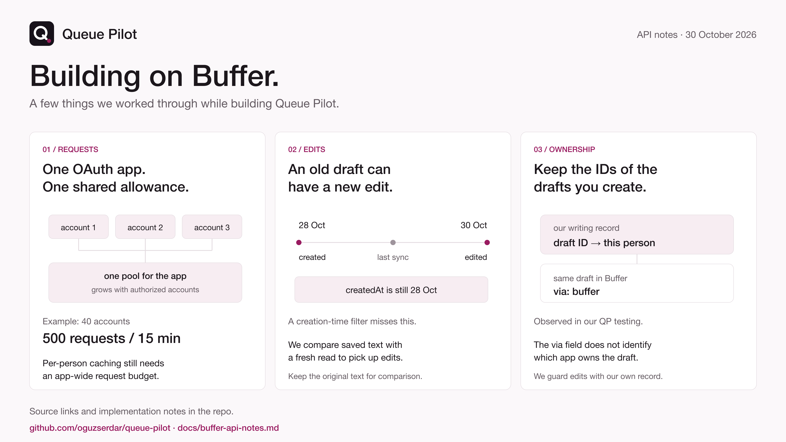

# Building on the Buffer API: what we learned

Notes from building Queue Pilot on Buffer's API. Putting them here so the next builder has somewhere to start. Source links and the code we use are included below.

Last checked: 30 October 2026. Use the [API limits page](https://developers.buffer.com/guides/api-limits.html) for current quotas and the [schema changelog](https://developers.buffer.com/changelog) for field changes. The 27 October rollout date comes from Buffer's [Discord announcement](https://discord.com/channels/956701996063285369/1371849521423974512/1564678705551376536).

## Sign-in and scopes

- Apps sign people in with OAuth 2.0 and PKCE. The scopes are `posts:read posts:write ideas:read ideas:write account:read account:write snippets:read snippets:write offline_access`. Ask for `offline_access` to get a refresh token. Queue Pilot asks for `posts:read posts:write ideas:read ideas:write account:read offline_access` (`src/lib/buffer/oauth.ts`).
- Post results (likes, clicks, reach) are not readable by OAuth apps. Buffer's [post metrics guide](https://developers.buffer.com/guides/post-metrics) limits them to personal API keys; the required `insightsRead` permission is unavailable to OAuth app clients. Queue Pilot currently learns from edits, not engagement metrics.
- During Buffer Commit everyone can create two extra app clients, and an app client's name can be changed after you create it (Buffer staff in the Buffer Community Discord, 22 Oct 2026).
- Include `prompt=consent` alongside `offline_access`, as in the [current authorization example](https://developers.buffer.com/guides/authentication.html). QP already sends both (`src/lib/auth.ts`). A [builder reported](https://discord.com/channels/956701996063285369/1371849521423974512/1565335572040523928) that adding the prompt resolved a missing refresh token.

## Staying inside the rate limits

- An OAuth app shares one request allowance across its users. Since 27 October, that allowance grows with the number of authorized Buffer accounts, up to 1,000. With `U` accounts, it gets `100 + 10U` requests per 15 minutes, `500 + 25U` per 24 hours and `15,000 + 100U` per 30 days. Personal API keys and Buffer's own MCP connections share a separate allowance based on the account's plan ([API limits](https://developers.buffer.com/guides/api-limits.html), [announcement](https://discord.com/channels/956701996063285369/1371849521423974512/1564678705551376536)).
- Read the `RateLimit` header on every response. It carries each window as `"100-in-15min";r=98;t=897`; the policy name changes with the quota. Identify a window by its length (`w`) in `RateLimit-Policy`, rather than its name. QP currently reads remaining requests and reset times; its parser doesn't read `w` yet. On HTTP 429, QP retries once only when `Retry-After` fits its five-second wait budget; otherwise it reports the reset time (`src/lib/buffer/client.ts`).
- We keep a saved copy of each person's channels, posting slots and posts from 7 days back to 14 ahead. Screens read that copy. Refreshes run one at a time per person, so opening several screens doesn't repeat the same API calls (`src/lib/buffer/snapshot.ts`).
- Combine top-level fields in one request, use aliases for repeated fields (up to 30 per request), and filter on Buffer's side ([efficient API usage](https://developers.buffer.com/guides/efficient-api-usage.html)).
- Catching edits needs another step. The [guide](https://developers.buffer.com/guides/efficient-api-usage.html) suggests a `createdAt` checkpoint for new posts. An older draft keeps its creation date when someone edits it, so that query misses the edit. `Post.updatedAt` is readable, but the published [post filters](https://developers.buffer.com/reference.html#PostsFiltersInput) don't include it. We refresh the posts in our saved time window and compare their text with our writing records. The guide currently documents polling, with no developer webhooks.
- QP's refresh lock and stored rate-limit headers are per user. They prevent duplicate refreshes for that user. Coordinating the shared OAuth pool across users still needs an app-wide throttle.

## Writing drafts

- `createContentItem` writes one item and a post for each channel in a single all-or-nothing call, and each network's post can have its own text and time ([content items](https://developers.buffer.com/guides/content-items.html)). It is marked Experimental, so keep a `createPost`-per-channel fallback behind the same function (`src/lib/save-drafts.ts`).
- For a draft with no channel yet, the experimental `createContentItemDraft` accepts a `correlationId`. Retrying with the same ID in the same organization returns the existing item ([reference](https://developers.buffer.com/reference.html#CreateContentItemDraftInput)). We haven't used this operation in QP. Its retry guarantee applies to that operation; it doesn't cover our `createPost` or `createContentItem` calls.
- `saveToDraft: true` keeps a post as a draft. Buffer does not check posting limits for drafts, so check them yourself before saving.
- Set `aiAssisted: true` on drafts an AI wrote.
- Images go in as a public URL with alt text: `ImageAssetInput` takes `url` and requires `metadata.altText`. There is no upload endpoint yet.

## Daily posting limits

- `dailyPostingLimits(input: { channelIds, date })` returns `{ channelId isAtLimit limit scheduled sent }` evaluated at the intended posting time. Since 19 Oct 2026, for X it counts the busiest rolling 24-hour window that a post at that time touches, including later scheduled posts. Other networks use the channel's local calendar day. The proposed post is not counted (schema changelog, 19 Oct 2026). Ask at each draft's intended time and trust `isAtLimit` (`src/lib/save-drafts.ts`).

## Changing only your own drafts

- Every post has `via: api | buffer | network`, but this field does not identify the app that owns a draft. During QP testing, drafts it created were labelled `buffer`. Approve, edit and delete require a saved writing record for the signed-in person (`src/lib/written-store.ts`). A draft from another app or typed in Buffer is refused.
- Queue Pilot never schedules or publishes on its own. Only your Approve schedules. The Approve action uses `editPost` with `saveToDraft: false` and keeps the slot time (`src/lib/approve-drafts.ts`). Connector tools cannot schedule.
- `editPost` with `saveToDraft: true` keeps the post a draft at its slot. `deletePost` returns `DeletePostSuccess` or an error, so count only success.

## Reading failures

- A failed post carries `error { message supportUrl }`. Show Buffer's own words and link its help page rather than writing your own.
- Reminder posts (`schedulingType: notification`) are published by the person, not by Buffer. Treat them as sent only when `notificationStatus` is `markedAsPublished`.

## Watching for changes

- Buffer announces schema updates in the `api-notifications` channel of the Buffer Community Discord. Recent examples: `ChannelAction.approvePosts` (15 Oct), the daily posting limit definition (19 Oct), replies and reactions configuration (21 and 22 Oct).
- A test that checks the fields you query against Buffer's published reference catches a renamed field before it reaches people (`src/lib/buffer/schema-fields.test.ts`).
