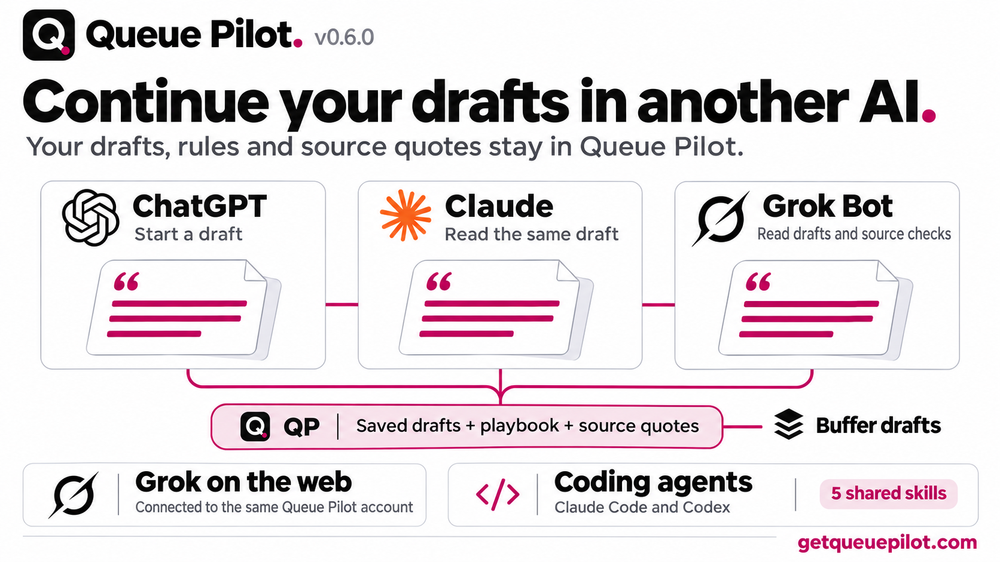
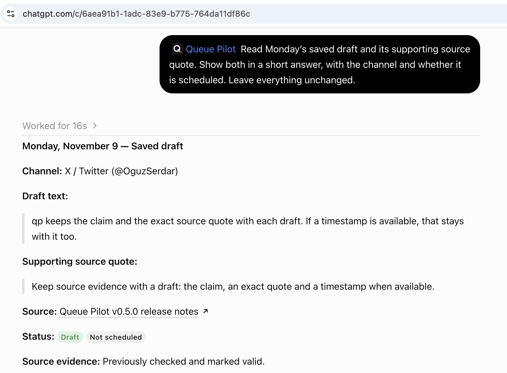
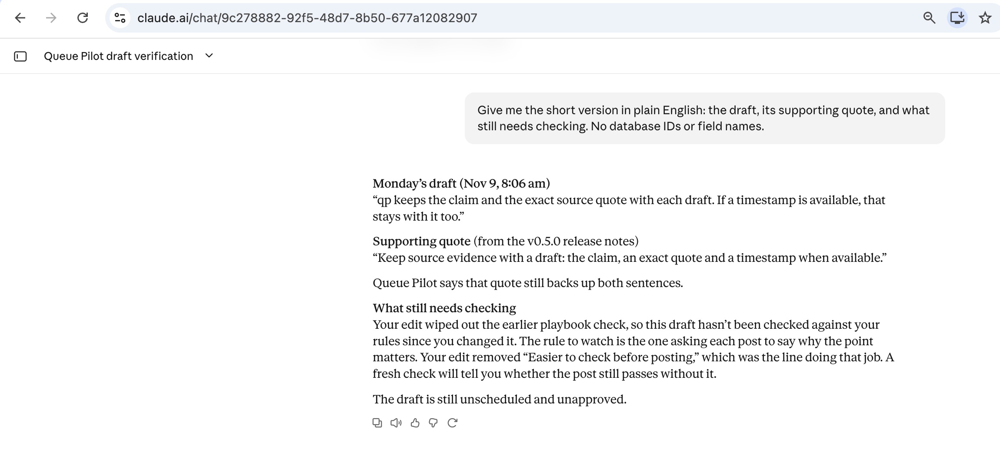
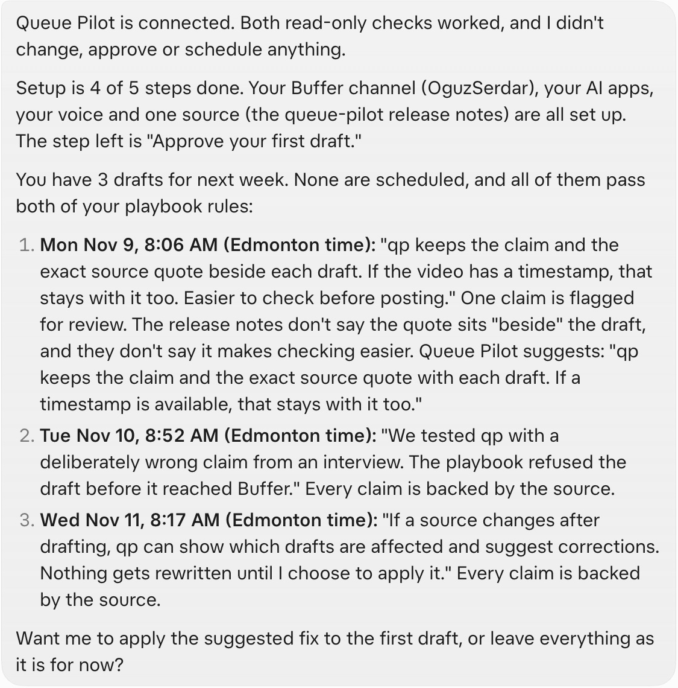
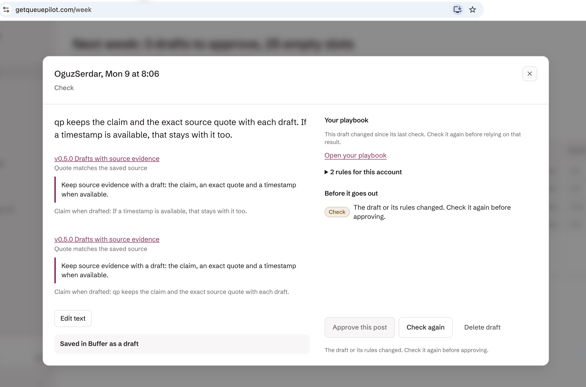

# v0.6.0 · Continue drafts in another assistant

Work on Buffer drafts from ChatGPT, Claude or Grok Bot. Queue Pilot keeps the drafts, writing rules and source evidence in the account, so the next assistant can continue from the same saved work.

## Connections and skills

- The setup prompt installs the same five skills for Claude Code and Codex: the main Queue Pilot skill, fill week, check week, fix drafts and check sources. The published copies now come from the plugin files, with a check to catch drift.
- Setup confirms an authenticated read before reporting a successful connection. Claude Code avoids adding a second connector when the plugin already provides one.
- Grok has one setup card with instructions for web and Grok Bot desktop. Native sign-in accepts valid local callbacks while retaining the existing callback checks and PKCE.
- Connection permissions show the app name and return destination. Recognized logos require a matching provider address rather than trusting a self-declared name.

## Drafts and evidence

- Repair citations on an existing Queue Pilot draft without creating another post. The repair verifies ownership, current text and the attached source before replacing evidence.
- Exact draft sentences and source quotations have explicit field guidance and specific mismatch messages. A failed meaning check remains a failed check after citation repair.
- The Buffer allowance shows correctly when Buffer returns a time window without a quota total.

## Optional web research

Two new tools, search_context and add_web_page, bring the connector to 47 tools. They require an Exa key in Admin. Search returns excerpts; a selected page can be saved as a source snapshot with its text and evidence for drafting. Pages over the 1,000,000-character request ceiling are labelled incomplete. Saved web pages are not automatically refreshed by Check sources; YouTube transcripts still use Supadata.

The hosted Exa success path has not been tested with a key. It remains off until configured. Missing-key handling has been tested.

## Verified workflow

ChatGPT saved three unscheduled drafts. After citation repair, Claude read the same three drafts and six source quotes. A separate coding-agent test edited one draft, repaired its citations and checked the saved source; an independent read confirmed the same draft and time. Grok web, Grok Bot, Codex CLI and Claude Code also completed authenticated reads. These results do not claim every operation was exercised in every client.

No posts were scheduled or published in this run. An edited draft’s old playbook verdict stays stale until checked again.

## Screenshots

Continue drafts in another assistant.

ChatGPT reads the saved draft and source quote.

Claude reads the same saved work.

Grok Bot reads the drafts and source checks, before the correction.

The corrected draft in Queue Pilot; the quote supports both sentences and its playbook check needs refreshing.
