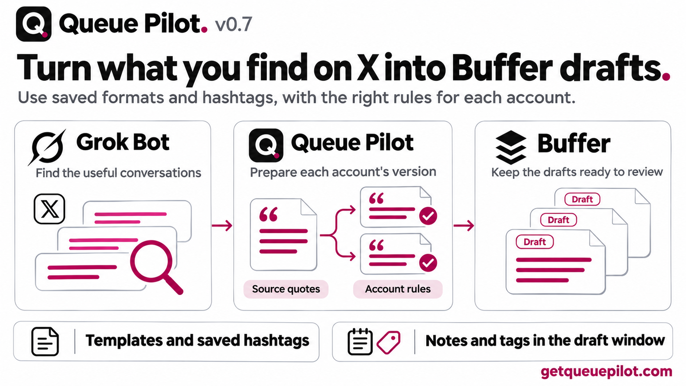
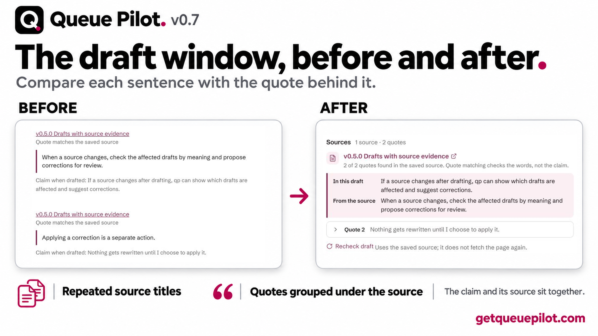
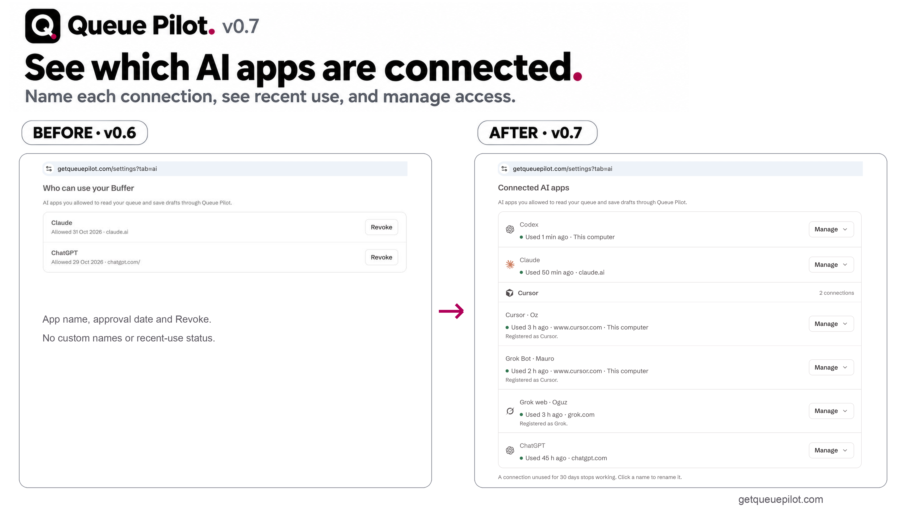

# v0.7.0 · Research with Grok Bot, draft in Buffer

Say you want to post about AI development. Ask Grok Bot to find posts getting attention in the last 24 hours, look at the releases and benchmarks behind them, and pick a subject you have something to say about. QP takes that research, writes in your saved voice and checks the draft against the rules for that account. The source quotes stay attached, and the draft lands in Buffer for review. That's the flow I wanted when I started this, and we've now run it end to end.

## More of Buffer, from the same chat

Queue Pilot now covers 37 of the 49 operations in Buffer's API, up from 9 in v0.6. That adds Ideas, post templates, Notes, tags and teammate information to the conversation. Saved hashtag sets are implemented too, but Buffer refused them on my account, so I haven’t verified that flow live.

The tools now tell the assistant: if Buffer’s own connector exposes the same action, use one connector for it, not both. QP’s draft checks, source evidence and learning stay in QP. Switching connectors must never bypass a refusal or request limit.

## Careful with Buffer's limits

QP now counts Buffer requests across users and servers before sending them. Assistant and background requests pause at 15 remaining in a known window. When the allowance is unknown, requests go one at a time until Buffer reports it. This keeps an eager assistant from blindly burning through the shared allowance.

## Easier to read

I rebuilt the draft window. The post, its sources, the checks and Notes sit together, each source shows once, and its quotes follow the post's order.

Connected AI apps is one row per connection now: name, last used and where it returns to. Grok Bot signs in with Cursor's registration, so it shows under Cursor with whatever name you give it. Queue Pilot doesn't guess.

## Safer writes

Retrying an unclear save doesn't create a second draft. If Buffer answers ambiguously, Queue Pilot reads back what actually happened before trying again. If a draft changes while it's being checked, it stops.

## What I tested, and what I didn't

Grok Bot read a public X post, kept its exact quote and saved a checked, unscheduled draft, which I then opened in Buffer. I also tested drafts before choosing an account, editing, refusing a stale edit, turning a draft into an account draft and retrying without a duplicate.

Not tested live: saved hashtag set writes (my Buffer account isn't allowed to use them), sending one draft to two real accounts, and every new-account case. Quote checks match the words, not whether the claim is true.

Code, skills and tests are MIT. Take whatever helps with your own Buffer build.

